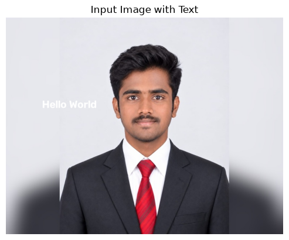
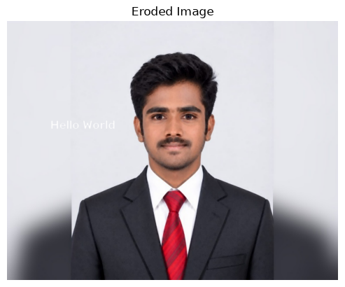
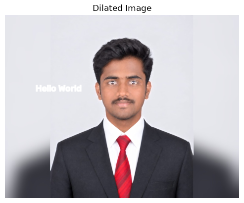

# Experiment 9 – Implementation of Erosion and Dilation

## Name
MUTHUAKASH M

## Register Number
212225230194

## Aim
To implement erosion and dilation operations on an image using OpenCV and Python, and to observe the effects of morphological operations on the image.

## Software Required
- Python
- Jupyter Notebook
- OpenCV (`cv2`)
- NumPy
- Matplotlib

## Input Image Required
- `Qno. 1.jpg`

Place the input image in the same folder as the Jupyter Notebook or Python program.

## Algorithm

1. Import the required libraries: OpenCV, NumPy, and Matplotlib.
2. Read the input image using `cv2.imread()`.
3. Add the text "Hello World" to the image using `cv2.putText()`.
4. Display the input image by converting it from BGR to RGB.
5. Create a 3 × 3 square kernel using `np.ones()`.
6. Apply erosion using `cv2.erode()` with one iteration.
7. Display the eroded image.
8. Apply dilation using `cv2.dilate()` with one iteration.
9. Display the dilated image.
10. Observe and compare the input, eroded, and dilated images.

## Program 1: Import Libraries

```python
import cv2
import numpy as np
import matplotlib.pyplot as plt
```

## Program 2: Read the Image

```python
image = cv2.imread("Qno. 1.jpg")
```

## Program 3: Add Text to the Image

```python
font = cv2.FONT_HERSHEY_SIMPLEX

cv2.putText(image, 'Hello World', (100, 250), font, 1,
            (255, 255, 255), 2, cv2.LINE_AA)
```

## Program 4: Display the Input Image

```python
plt.imshow(cv2.cvtColor(image, cv2.COLOR_BGR2RGB))
plt.title("Input Image with Text")
plt.axis('off')
```

### Output – Input Image



## Program 5: Create the Kernel

```python
kernel = np.ones((3, 3), np.uint8)
```

## Program 6: Apply Erosion

```python
eroded_image = cv2.erode(image, kernel, iterations=1)
```

## Program 7: Display the Eroded Image

```python
plt.imshow(cv2.cvtColor(eroded_image, cv2.COLOR_BGR2RGB))
plt.title("Eroded Image")
plt.axis('off')
```

### Output – Eroded Image



## Program 8: Apply Dilation

```python
dilated_image = cv2.dilate(image, kernel, iterations=1)
```

## Program 9: Display the Dilated Image

```python
plt.imshow(cv2.cvtColor(dilated_image, cv2.COLOR_BGR2RGB))
plt.title("Dilated Image")
plt.axis('off')
```

### Output – Dilated Image



## Result

Thus, erosion and dilation operations were successfully implemented on an image using OpenCV and Python. The effects of erosion (shrinking) and dilation (expanding) were observed and displayed.